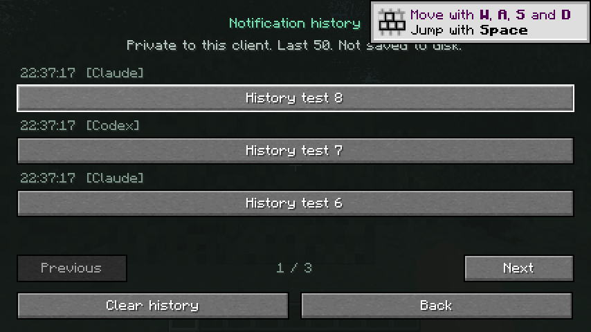

# Verification record

## Automated behavior

Both Fabric targets run checks for configuration recovery and permissions, actual HTTP delivery and authentication, queue bounds and concurrent expiry, receiver shutdown/restart, and the private 50-entry history. Python CLI checks cover generated Codex and Claude hook commands, health diagnostics, Unicode limits, malformed input, offline behavior, setup previews, preservation, backups, locking, and repeatable setup.

Release checks inspect both built JARs, verify version metadata and checksums, compare ZIP bytes after file timestamp changes, exclude untracked scratch files, and reject dirty tracked source.

The first complete six-target CI run passed on Linux, Windows, and macOS for Minecraft 1.21.1 with Java 21 and Minecraft 26.2 with Java 25. See [the run](https://github.com/arogan178/minenotify/actions/runs/38304786309). Later changes repeat CI on the final pull-request revision.

## Native Minecraft 26.2

The local Linux development client uses Java 27 to run the mod compiled for Java 25. Native verification exercises the same client adapter as the installable JAR.

The F8 settings layout fits the minimum 427×240 GUI used by this test. Eight notifications sent through the real HTTP bridge appear newest first on three history pages. Previous/Next navigation and selected details work. With previews disabled, details show the hidden-preview notice instead of the response body. The matching setting is saved to the runtime config. Enabling previews shows the wrapped response and detail-page navigation. Clearing from details returns to an empty history list.

During launch, this desktop's XWayland window remained stuck in GLFW's window visibility wait. A visibility event sent only to the owned test window let startup continue. This test-harness workaround changes no mod code or user desktop configuration.

## Limits

Cross-platform CI covers builds and Java/Python behavior, not actual Windows/macOS launcher installation or rendered gameplay. The new history screen has native gameplay evidence on 26.2; its 1.21.1 adapter compiles and shares the checked history model, but still needs a fresh gameplay check. Earlier screenshots show the original 1.21.1 notification/settings UI.

Fixture checks do not edit global agent settings. A prior isolated Claude Code session verified execution of the generated Stop hook. Ordinary web chat and automatic T3 completion capture remain outside this release.

## Earlier release verification

### Minecraft clients

A native Minecraft 1.21.1 Fabric client received a message from the helper and displayed a popup. Its F8 settings screen opened, and the user confirmed notification delivery.

A native Minecraft 26.2 Fabric client joined a single-player world as `NotifyTest`. A message sent through the helper displayed in both local chat and the HUD popup, including response text. The game's own screenshot captured that result.

The initial 26.2 test launch failed because its test username was 18 characters, exceeding Minecraft's 16-character limit. Relaunching with `NotifyTest` resolved the login error. This was a test-launch argument error rather than a mod protocol error.

The user's pause report matched Minecraft's `pauseOnLostFocus` preference. The release adds an explicit settings button for that global preference. It does not change the preference automatically.

### Live Claude Code hook

Claude Code 2.1.296 ran a real print-mode session with temporary hook settings, default user/project settings disabled, MCP configurations disabled, and no model tools. The prompt requested the exact response `CLAUDE_BRIDGE_OK`.

Claude completed the response and invoked the generated Stop command. The actual Java `LocalReceiver` accepted a notification with source `Claude Code`, a response-finished title, and message `CLAUDE_BRIDGE_OK`. Both processes exited successfully. This tested real hook execution through the Python adapter and the mod receiver. User-level Claude settings were not edited.

Permission, idle, and failure events were tested with documented input payloads rather than real permission dialogs or induced API failures. Minecraft rendering for these new events was not rerun because the mod and its notification protocol are unchanged.

Automatic completion events from a live Codex CLI session, multiplayer-server compatibility, and automatic ChatGPT or T3 Code event capture were not exercised. Codex's documented `notify` event format is covered by the bridge check. ChatGPT and T3 Code need a separate event hook.
